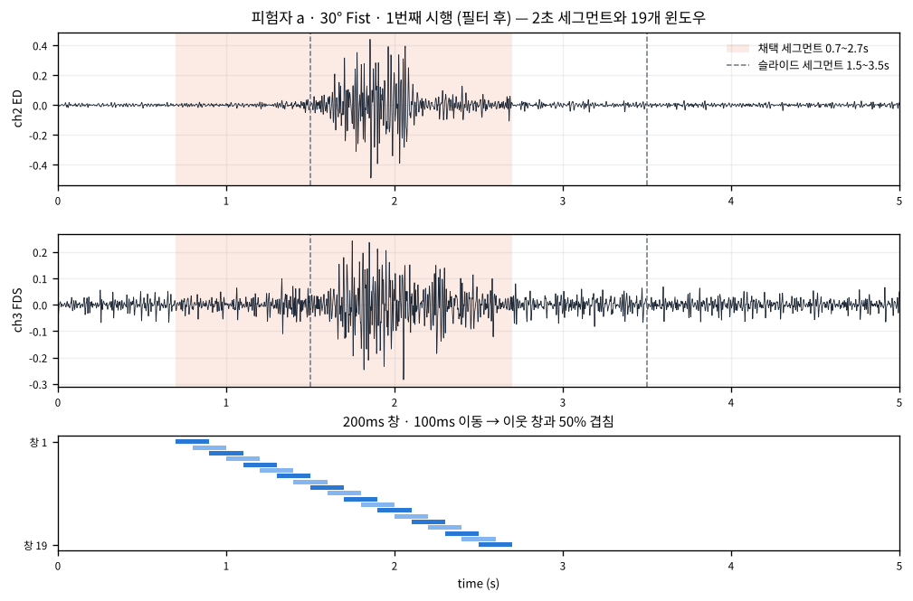
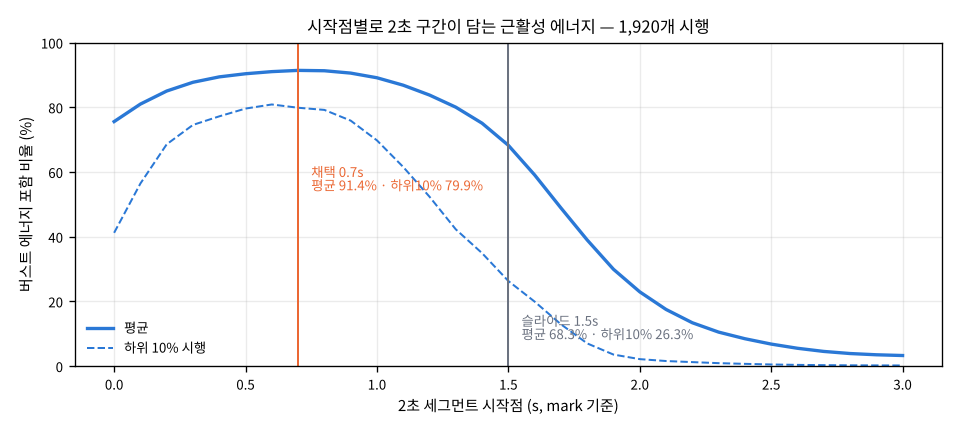
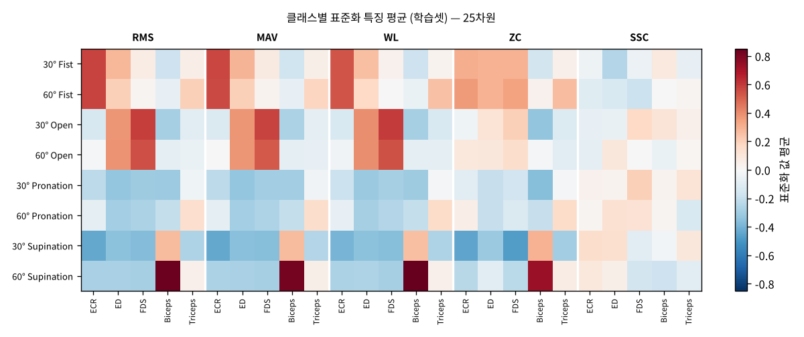

# Step 2 — sEMG 손동작 × 팔꿈치 각도 동시 분류

전완 3채널 + 상완 2채널 sEMG로 **손동작 4종(주먹 쥐기 · 손 펴기 · 회내 · 회외) × 팔꿈치 각도 2종(30° · 60°)
= 8클래스**를 한 번에 분류하는 문제의 주차별 실습 저장소입니다.

- 원 논문: *Simultaneous Classification of Hand Gestures and Elbow Angles Using sEMG Signals: A Comparison of
  Machine Learning Performances.* Biomedical Engineering Letters (2026). DOI 10.1007/s13534-026-00607-7
- 데이터: https://github.com/TestUser-alt-dev/sEMG-Hand-Gesture-Elbow-Angle-Dataset (논문 원 데이터, 8명 × 8클래스 × 30회)
- 작성자: 19146809 · 컴퓨터공학과 · 김지훈

| 주차 | 주제 | 코드 | 산출물 |
|---|---|---|---|
| [1주차](#1주차--문제-정의와-데이터-이해) | 문제 정의와 데이터 이해 | `src/week1_lab.py` | `results/week1/` |
| [2주차](#2주차--전처리와-특징-추출) | 전처리와 특징 추출 | `src/week2_lab.py` | `results/week2/` (`dataset.npz`) |

---

# 1주차 — 문제 정의와 데이터 이해

이번 주는 모델을 만들지 않고, 8클래스가 무엇인지 이해하고 신호를 눈으로 확인하는 데까지 진행했습니다.

## 1-1. 실습 단계와 산출물

| 단계 | 내용 | 산출물 |
|---|---|---|
| 1. 환경 점검 | Step 1 가상환경 + `xgboost` 추가 설치, 버전 확인 | `results/week1/env_check.txt` |
| 2. 데이터 확보 | 논문 원 데이터(방법 A와 동일한 8클래스 구성) 64개 CSV | `data/README.md` |
| 3. 데이터 구조 파악 | 클래스별 시행 수, 배열 모양, 채널 수 | `results/week1/data_summary.json`, `results/week1/class_counts.csv` |
| 4. 채널별 신호 그리기 | 5채널 파형, 30° vs 60° 비교, 클래스×채널 RMS | `results/week1/ch5_example.png`, `angle_side_by_side.png`, `angle_envelope_grid.png`, `class_channel_rms.png` |
| 5. 클래스 설계안 | 8클래스 목록 · 채널 대응 · 설계 근거 · 대안 · 확장 문제 | 리포트 ⑤ 페이지, `results/week1/angle_rms_table.csv` |

## 1-2. 데이터 요약

| 항목 | 값 |
|---|---|
| 파일 | 64개 = 8명(a~h) × 2각도 × 4동작, 이름 규칙 `[피험자]_[각도] [동작].csv` |
| 파일 구조 | 파일 하나에 30회 시행이 연속 기록됨. `mark` 열이 1인 위치가 시행 시작(간격 4,999~5,001샘플) |
| 열 | `bandpass 1`~`bandpass 5`(5채널), `time`, `onset`, `mark` |
| 시행 배열 | 시행당 (5000, 5) — 5초 × 1,000Hz × 5채널, 전체 (1920, 5000, 5) |
| 클래스 분포 | 8클래스 모두 240시행 (8명 × 30회) — 불균형 없음 |
| 채널 | ch1 ECR(요측수근신근) · ch2 ED(총지신근) · ch3 FDS(천지굴근) · ch4 Biceps(상완이두근) · ch5 Triceps(상완삼두근) |

슬라이드의 `label_of`는 `30_fist_trial01.csv` 형식을 가정하므로, 실제 파일명에 맞게 정규식으로 고치고
`mark` 기준으로 시행을 자르는 `split_trials`를 추가했습니다(`src/week1_lab.py`).

## 1-3. 주요 관찰


- **동작 구간 위치가 슬라이드와 다릅니다.** 1,920개 시행의 포락선 최대 시점 중앙값은 1.69초(10~90%: 1.21~2.07초)이고, 최대가 2~3초 안에 오는 시행은 14.7%뿐입니다.
실제 활동 구간은 약 1.0~2.5초입니다.
- **동작은 채널 패턴으로 갈립니다.** 주먹 쥐기는 전완 3채널, 손 펴기는 ED·FDS, 회외는 Biceps가 지배적이고, 회내는 모든 채널이 낮습니다.


- **각도는 같은 패턴의 크기를 바꿉니다.** 활동 구간 RMS의 60°/30° 비율은 20칸 중 17칸에서 1보다 컸고(1.0~1.5배),
- 가장 큰 차이는 회외의 Biceps 1.55배(8명 중 7명)입니다.
- 주먹 쥐기·손 펴기의 전완 채널은 0.95~1.08배로 거의 변하지 않았고 피험자마다 방향이 엇갈렸습니다.


| 동작 \ 채널 | ECR | ED | FDS | Biceps | Triceps |
|---|---:|---:|---:|---:|---:|
| Fist | 0.99 (4/8) | 0.96 (4/8) | 0.95 (5/8) | 1.11 (6/8) | 1.14 (7/8) |
| Open | 1.18 (7/8) | 1.08 (5/8) | 1.03 (4/8) | 1.27 (6/8) | 1.06 (6/8) |
| Pronation | 1.18 (7/8) | 1.15 (7/8) | 1.12 (5/8) | 1.12 (5/8) | 1.10 (5/8) |
| Supination | 1.29 (7/8) | 1.14 (4/8) | 1.34 (8/8) | **1.55 (7/8)** | 1.38 (7/8) |

60°/30° 활동 구간 RMS 비율, 괄호는 60°가 더 큰 피험자 수.

---

# 2주차 — 전처리와 특징 추출

원신호를 필터링하고 2초 구간을 200ms 창 19개로 잘라, 창마다 시간영역 특징 5종 × 5채널 = 25차원 벡터를 만들었습니다.
시행 단위로 먼저 학습/테스트를 나눈 뒤 특징을 만들고, 학습셋 통계로 표준화해 `dataset.npz`로 저장했습니다.

## 2-1. 실습 단계와 산출물

| 단계 | 내용 | 산출물 |
|---|---|---|
| 1. 필터 적용 | 60Hz 노치(Q=30) + 20–450Hz 4차 Butterworth, `filtfilt` | `results/week2/filter_check.png`, `filter_std.txt` |
| 2. 분석 구간 | 2초(2,000샘플) 세그먼트, 시작점 0.7초 | `results/week2/segment_start.png` |
| 3. 슬라이딩 윈도우 | 200ms 창 · 100ms 이동 → (19, 200, 5) | `results/week2/segment_windows.png` |
| 4. 시간영역 특징 | RMS · MAV · WL · ZC · SSC 직접 구현 → (25,) | `results/week2/zc_threshold.csv` |
| 5. 데이터셋 | 시행 단위 8:2 분할 후 각 집합 안에서만 특징 생성 | `results/week2/dataset_summary.json` |
| 6. 표준화와 저장 | `StandardScaler` 학습셋 fit → 테스트셋 transform | `results/week2/dataset.npz`, `check_log.txt` |

## 2-2. 데이터셋 요약

| 항목 | 값 |
|---|---|
| 학습 / 테스트 시행 | 1,536 / 384 — 피험자×클래스(64그룹)마다 30회 중 24:6 |
| 학습 / 테스트 샘플(창) | (29184, 25) / (7296, 25) — 학습이 테스트의 4.0배 |
| 클래스별 | 모든 클래스 학습 3,648 · 테스트 912 창 |
| 학습 ∩ 테스트 시행 | 0 (겹치는 시행 없음) |
| 표준화 확인 | 학습셋 평균 ≈ 0(1e-14), 표준편차 1.000000 · 테스트셋 평균 절댓값 최대 0.031 |
| 특징 순서 | RMS×5 → MAV×5 → WL×5 → ZC×5 → SSC×5, 각 블록의 채널 순서 ECR · ED · FDS · Biceps · Triceps |

```python
d = np.load('results/week2/dataset.npz')
Xtr, ytr, Xte, yte = d['Xtr'], d['ytr'], d['Xte'], d['yte']   # ytr 예: '30_fist'
# 추가 키: trial_tr/te(시행 ID), subject_tr/te, feature_names, classes, scaler_mean, scaler_scale
```

## 2-3. 주요 관찰



- **세그먼트 시작점을 1.5초에서 0.7초로 옮겼습니다.** 슬라이드도 1.5초는 실습 가정이라 데이터에 맞게 조정하라고 합니다. 시작점별로 2초 구간이 담는 버스트 에너지를 1,920개 시행에서 계산하니 0.7초가 평균 91.4%로 최대였고, 1.5초는 68.3%(하위 10% 시행은 26.3%)에 그쳤습니다.



- **필터는 이미 걸린 상태였습니다.** 저장소의 `bandpass` 열은 노치 + 대역통과가 적용된 신호라 60Hz 봉우리가 처음부터 없습니다. 다시 걸어도 30–400Hz 전력은 1.04~1.09배로 유지되고, 대역 밖(20Hz 아래, 450Hz 위)만 100배 이상 추가로 줄었습니다.
- **ZC 임계값 0.01은 이 신호에 비해 큽니다.** th=0이면 창당 22~29회지만 0.01이면 3~13회로 줄고, 채널-창의 28%가 ZC=0이 됩니다. 슬라이드 조건을 그대로 쓰고 기록만 해 두었습니다.
- **RMS·MAV·WL은 거의 같은 정보입니다.** 클래스별 평균 무늬가 세 블록에서 거의 똑같습니다.



- 이 분할은 같은 피험자의 다른 시행이 양쪽에 들어가는 피험자 내 평가입니다. 처음 보는 사람에 대한 성능은 피험자 단위 분할로 따로 확인해야 합니다.

---

## 실행 방법

```bash
# 0) 환경 (Step 1 가상환경 재사용)
source .venv/bin/activate            # Windows: .venv\Scripts\activate
pip install -r requirements.txt      # 신규 패키지는 xgboost

# 1) 데이터 받기 (약 930MB, 저장소에는 포함하지 않음)
git clone https://github.com/TestUser-alt-dev/sEMG-Hand-Gesture-Elbow-Angle-Dataset data/sEMG-Hand-Gesture-Elbow-Angle-Dataset

# 2) 1주차 실습 단계 1~5 → results/week1/ (약 1분)
python src/week1_lab.py

# 3) 2주차 실습 단계 1~6 → results/week2/ , dataset.npz (약 30초)
python src/week2_lab.py
```

## 파일 구조

| 파일 | 설명 |
|---|---|
| `src/week1_lab.py` | 1주차 실습 1~5단계. 환경 점검, 파일명 파싱(`label_of`), `mark` 기준 시행 분할, 구조 요약, 5채널 그림, 30°/60° 비교 |
| `src/week2_lab.py` | 2주차 실습 1~6단계. `preprocess` · `cut` · `make_windows` · `td_features`, 시행 단위 분할, 표준화·저장 (파일 읽기는 1주차 코드 재사용) |
| `report/generate_week1_report.py` | 1주차 제출물 5개 항목 PDF 생성 → `report/19146809_김지훈_1주차.pdf` |
| `report/generate_week2_report.py` | 2주차 제출물 6개 항목 PDF 생성 → `report/19146809_김지훈_2주차.pdf` |
| `results/week1/` | 1주차 산출물(그림, 요약 JSON/CSV) |
| `results/week2/` | 2주차 산출물(그림, 요약, `dataset.npz`) |

