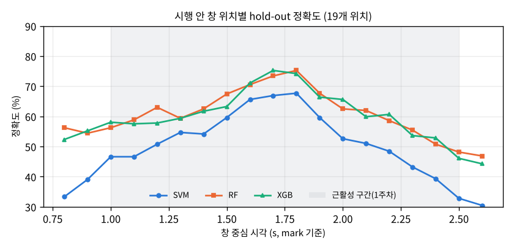
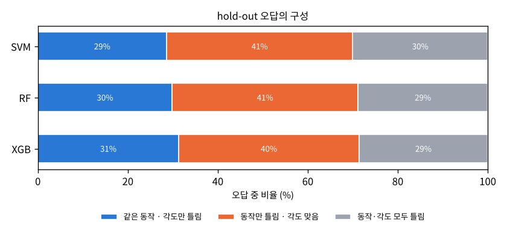
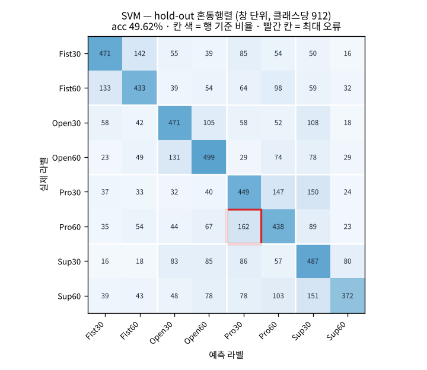
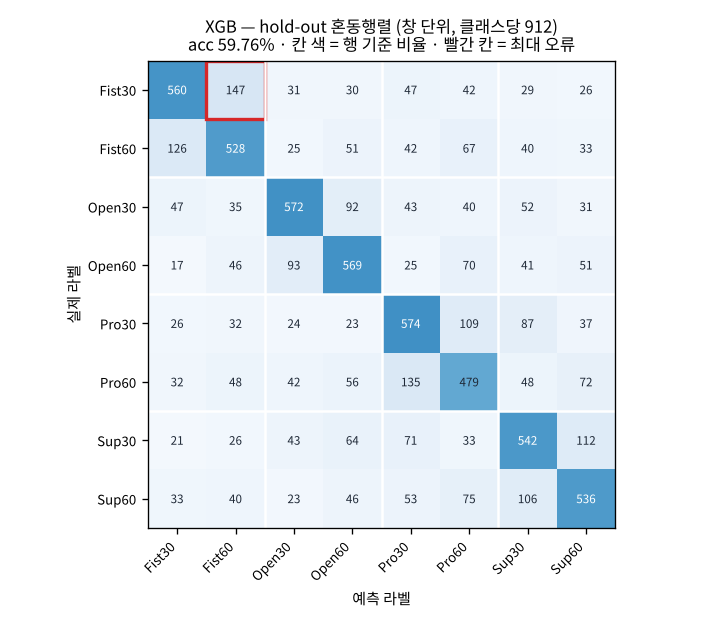
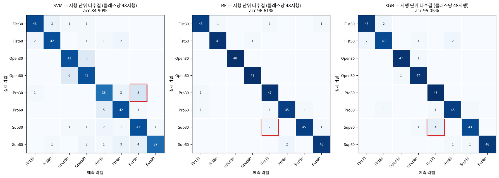

# AI 모델 재현 및 성능 비교 — sEMG 손동작 × 팔꿈치 각도 동시 분류

전완 3채널 + 상완 2채널 sEMG로 손동작 4종(주먹 쥐기 · 손 펴기 · 회내 · 회외) × 팔꿈치 각도 2종(30° · 60°)
= 8클래스를 한 번에 분류하고, SVM · Random Forest · XGBoost 세 모델의 성능을 같은 조건에서 비교했습니다.

- 원 논문: *Simultaneous Classification of Hand Gestures and Elbow Angles Using sEMG Signals: A Comparison of
  Machine Learning Performances.* Biomedical Engineering Letters (2026). DOI 10.1007/s13534-026-00607-7
- 데이터: https://github.com/TestUser-alt-dev/sEMG-Hand-Gesture-Elbow-Angle-Dataset (논문 원 데이터, 8명 × 8클래스 × 30회)
- 작성자: 19146809 · 컴퓨터공학과 · 김지훈
- 주차별 실습 기록: [1주차 — 문제 정의와 데이터 이해](docs/week1.md) · [2주차 — 전처리와 특징 추출](docs/week2.md)

---

## 1. 코드 설명

### 사용한 데이터

| 항목 | 값 |
|---|---|
| 피험자 / 클래스 | 8명(a~h) / 8클래스 = 4동작(Fist · Open · Pronation · Supination) × 2각도(30° · 60°) |
| 시행 수 | 클래스당 240회(8명 × 30회), 총 1,920시행 — 64개 CSV, 파일 하나에 30회 연속 기록 |
| 채널 | 5채널 — ECR(요측수근신근) · ED(총지신근) · FDS(천지굴근) · Biceps(상완이두근) · Triceps(상완삼두근) |
| 샘플링 / 시행 길이 | 1,000Hz / 5초(휴식 2 · 동작 1 · 휴식 2), `mark` 열로 시행 시작 위치 표시 |

### 전처리 방법

1. 필터: 60Hz 노치(Q=30) + 20–450Hz 4차 Butterworth 대역통과, `filtfilt`로 위상 지연 없이 적용 (파일 단위로 거른 뒤 시행 분할)
2. 분석 구간: 시행마다 2초(2,000샘플) — 시작점 0.7초. 1주차에 근활성이 mark 기준 1.0~2.5초에 있음을 확인했고, 0.7초 시작이 버스트 에너지를 평균 91.4% 담아 가장 컸습니다(슬라이드 기본값 1.5초는 68.3%).
3. 윈도우: 200ms 창 · 100ms 이동(50% 오버랩) → 시행당 19개 창
4. 특징: 창마다 RMS · MAV · WL · ZC(임계값 0.01) · SSC × 5채널 = 25차원 (numpy로 직접 구현)
5. 표준화: `StandardScaler`를 학습셋에만 fit, 테스트셋은 transform

### 사용한 AI/ML 모델

| 모델 | 설정 | 비고 |
|---|---|---|
| SVM | `SVC(kernel='rbf', C=1.0, gamma='scale')` | 기본값, 표준화 필수 |
| Random Forest (RF) | `n_estimators=100, random_state=42` | 기본값, 트리 100개 다수결 |
| XGBoost (XGB) | `n_estimators=400, max_depth=6, learning_rate=0.05, subsample=0.9, colsample_bytree=0.8` | 논문의 예비 튜닝 값 |

논문과 같이 SVM·RF는 기본값, XGBoost만 튜닝 값을 썼으므로 완전히 대칭적인 비교는 아닙니다.

### 학습 및 테스트 방법

- 분할: 시행 단위로 먼저 학습 80% / 테스트 20%로 나눈 뒤 각 집합 안에서만 창과 특징을 만듭니다. 50% 겹치는 창이 학습·테스트 양쪽에 섞이는 누수를 막기 위해서입니다. 층화는 피험자×클래스(64그룹) 기준이라 그룹마다 30회 중 24:6입니다.
  → 학습 1,536시행(29,184창), 테스트 384시행(7,296창), 클래스마다 학습 3,648 · 테스트 912창(완전 균형), 학습∩테스트 시행 0개
- hold-out: 위 분할로 세 모델을 학습해 Accuracy, macro Precision / Recall / F1, 혼동행렬을 구했습니다(창 단위). macro 평균은 실습 선택입니다.
- 시행 단위 다수결(보조): 한 시행의 19개 창 예측을 다수결로 묶은 정확도도 함께 보고합니다. 논문 수치와 비교하기 위해서입니다(2장 참고).
- 5-fold 교차검증: 1,920개 시행을 `StratifiedKFold(5, shuffle=True, random_state=42)`로 나누고, 폴드마다 scaler를 학습 폴드에서만 새로 fit 합니다.
- 통계 검정: 폴드별 정확도로 세 쌍의 대응표본 t-검정(`scipy.stats.ttest_rel`), 유의수준 0.05
- 보조 분석: LOSO(7명 학습 → 남은 1명 평가, 8회)로 처음 보는 사람에 대한 성능 확인

### 실행 방법

```bash
# 0) 환경 (Python 3.13, CPU)
python -m venv .venv
source .venv/bin/activate            # Windows: .venv\Scripts\activate
pip install -r requirements.txt

# 1) 데이터 받기 (약 930MB, 저장소에는 포함하지 않음)
git clone https://github.com/TestUser-alt-dev/sEMG-Hand-Gesture-Elbow-Angle-Dataset data/sEMG-Hand-Gesture-Elbow-Angle-Dataset

# 2) 전처리 · 특징 추출 → results/week2/dataset.npz (약 30초)
python src/week2_lab.py

# 3) 세 모델 학습 · hold-out · 혼동행렬 · 5-fold · t-검정 · LOSO → results/week3/ (2코어 CPU 약 20분)
python src/week3_lab.py
#    LOSO를 빼고 빠르게:  python src/week3_lab.py --no-loso
```

### 코드 설명

| 파일 | 설명 |
|---|---|
| `src/week1_lab.py` | 데이터 로딩 기초 — 파일 목록, 파일명 파싱(`label_of`), `mark` 기준 시행 분할, 데이터 구조 확인·시각화 |
| `src/week2_lab.py` | 전처리 — `preprocess`(필터) · `cut`(2초 구간) · `make_windows`(200ms 창) · `td_features`(25차원), 시행 단위 분할, 표준화, `dataset.npz` 저장 |
| `src/week3_lab.py` | 전체 실험 — 세 모델 학습, hold-out 평가, 혼동행렬·오류 유형, 5-fold 교차검증, 대응표본 t-검정, 학습·추론 시간, LOSO |
| `results/week2/dataset.npz` | 표준화된 학습/테스트 특징 `Xtr (29184, 25)` · `Xte (7296, 25)`와 라벨, 시행 ID, 피험자 |
| `results/week3/results.json` | 모델별 지표 · 클래스별 P/R/F1 · 혼동행렬 · 폴드별 정확도 · p값 · 시간 · LOSO |
| `results/week3/*.png` | 혼동행렬(모델별, 시행 다수결), 오류 유형, 창 위치별 정확도 |
| `report/` | 1·2주차 제출 PDF와 생성 스크립트 |

---

## 2. 모델 성능 비교

hold-out 테스트셋(384시행, 7,296창) 기준. Precision / Recall / F1은 8클래스 macro 평균입니다.

| Model | Accuracy | Precision | Recall | F1-score |
|---|---:|---:|---:|---:|
| SVM | 49.62% | 50.80% | 49.62% | 49.74% |
| RF | 60.50% | 60.55% | 60.50% | 60.51% |
| XGB | 59.76% | 59.88% | 59.76% | 59.79% |

같은 예측을 시행 단위로 묶은 결과(19개 창 다수결, 384시행)와 5-fold 교차검증:

| Model | 시행 다수결 Accuracy | 시행 다수결 F1 | 5-fold Accuracy (창) | 5-fold Accuracy (시행 다수결) |
|---|---:|---:|---:|---:|
| SVM | 84.90% | 84.95% | 49.59 ± 0.41% | 84.06 ± 1.40% |
| RF | 96.61% | 96.61% | 61.10 ± 0.58% | 96.67 ± 0.58% |
| XGB | 95.05% | 95.04% | 60.08 ± 0.43% | 95.05 ± 0.52% |

### 성능 분석

RF가 네 지표 모두에서 가장 높았습니다(F1 60.51%). XGBoost는 0.7%p 차이로 2위였고, SVM은 RF보다 10.8%p 낮았습니다. 5-fold에서도 순위가 같고(RF 61.10 ± 0.58%) 폴드 간 표준편차가 0.4~0.6%p로 작아, 분할 운에 따른 순위 변동은 없었습니다.

- RF와 XGBoost는 특징 하나씩 임계값으로 나누는 트리 모델이라, 25차원 중 진폭 계열(RMS·MAV·WL)이 강하게 상관되고 ZC가 정수값인 이 특징 공간을 그대로 잘 다룹니다. RF는 깊은 트리 100개를 평균내 분산을 줄였고, 학습도 XGBoost(약 15초)보다 빨랐습니다(약 8초).
- SVM은 기본값(C=1, gamma='scale') 그대로라 RBF 경계가 지나치게 매끄럽습니다. 동작 피크 근처가 아닌 창에서 특히 약했습니다(창 위치별 정확도에서 양 끝 30~40%, 트리 모델은 45~55%).

논문과의 비교: 창 하나 단위 정확도는 60%대지만, 같은 예측을 시행 단위로 다수결하면 RF 5-fold가 96.67 ± 0.58%로 논문의 RF 96.72 ± 0.58%와 거의 같습니다. 논문 수치는 시행(세그먼트) 단위 평가로 보는 것이 맞고, 200ms 창 하나만으로는 8클래스를 60% 정도밖에 맞히지 못한다는 점이 이번 재현에서 새로 드러났습니다.



---

## 3. Confusion Matrix 분석

행 = 실제 라벨, 열 = 예측 라벨(창 단위, 클래스당 912개). 칸 색은 행 기준 비율이고, 빨간 테두리는 최대 오류 칸, 흰 선은 동작 경계입니다(같은 동작의 30°·60°가 이웃).
라벨: Fist = 주먹 쥐기, Open = 손 펴기, Pro = 회내(Pronation), Sup = 회외(Supination).



오답을 세 가지로 나눴을 때 세 모델 모두 비슷한 구성입니다. 참고로 오답이 무작위라면 "같은 동작·각도만 틀림"은 7칸 중 1칸이라 14%여야 하는데, 실제로는 29~31%로 약 2배입니다. 같은 동작의 두 각도가 특히 잘 헷갈린다는 뜻입니다.

### Model 1 — SVM



| 클래스 | Fist30 | Fist60 | Open30 | Open60 | Pro30 | Pro60 | Sup30 | Sup60 |
|---|---:|---:|---:|---:|---:|---:|---:|---:|
| Precision | 58.0% | 53.2% | 52.2% | 51.6% | 44.4% | 42.8% | 41.6% | 62.6% |
| Recall | 51.6% | 47.5% | 51.6% | 54.7% | 49.2% | 48.0% | 53.4% | 40.8% |

분석

- 가장 잘 분류된 클래스: Fist30 — F1 54.6%, 정밀도 58.0%. 주먹 쥐기는 전완 3채널이 모두 크게 반응해 다른 동작과 패턴이 뚜렷합니다.
- 가장 많이 오분류된 클래스: Sup60 — 재현율 40.8%로 최저(912개 중 540개 오답). Pro60도 F1 45.3%로 낮습니다.
- 주요 오분류 유형: Pro60 → Pro30 (162건), Sup60 → Sup30 (151건), Pro30 → Sup30 (150건), Pro30 → Pro60 (147건). 회내·회외 네 클래스끼리의 혼동이 상위를 차지합니다.
- 오분류가 발생한 이유에 대한 분석: 회내와 회외는 전완을 비트는 동작이라 1주차에서 다섯 채널 모두 활성이 낮았고(활동 구간 RMS가 주먹 쥐기의 절반 이하), 신호 대 잡음비가 낮은 창에서는 두 회전 동작과 두 각도가 거의 같은 특징값을 가집니다. 기본값 RBF SVM은 이 작은 차이를 가를 만큼 경계를 세밀하게 그리지 못했고, 피크에서 먼 휴식 쪽 창(정확도 30~40%)에서 오답이 집중됐습니다.

### Model 2 — Random Forest


| 클래스 | Fist30 | Fist60 | Open30 | Open60 | Pro30 | Pro60 | Sup30 | Sup60 |
|---|---:|---:|---:|---:|---:|---:|---:|---:|
| Precision | 62.2% | 59.2% | 66.1% | 61.8% | 57.7% | 55.7% | 59.8% | 61.8% |
| Recall | 63.6% | 58.6% | 62.9% | 60.7% | 61.8% | 54.7% | 61.4% | 60.2% |

분석

- 가장 잘 분류된 클래스: Open30 — F1 64.5%, 정밀도 66.1%. 손 펴기는 ED·FDS가 가장 크게 반응하는(1주차 활동 구간 RMS 86~107) 가장 강한 신호입니다.
- 가장 많이 오분류된 클래스: Pro60 — F1 55.2%, 재현율 54.7%.
- 주요 오분류 유형: Fist30 → Fist60 (139건), Fist60 → Fist30 (118건), Pro60 → Pro30 (113건), Pro30 → Pro60 (113건), Open60 → Open30 (99건). 상위 다섯 개가 모두 같은 동작의 두 각도 사이 혼동입니다.
- 오분류가 발생한 이유에 대한 분석: 1주차에서 확인했듯 각도는 새 채널을 켜지 않고 같은 패턴의 크기를 1.0~1.5배 바꿀 뿐이며, 주먹 쥐기의 전완 채널은 0.95~0.99배로 거의 변하지 않았습니다. 각도 정보가 주로 상완 2채널의 작은 진폭 차이에만 있어서, 동작은 맞히고 각도만 틀리는 오류가 가장 많습니다. 논문도 같은 동작의 두 각도 간 혼동을 주요 오류로 설명합니다. 다만 시행 단위 다수결에서는 이런 창 단위 오류가 대부분 상쇄되어 384시행 중 13개만 틀렸습니다.

### Model 3 — XGBoost



| 클래스 | Fist30 | Fist60 | Open30 | Open60 | Pro30 | Pro60 | Sup30 | Sup60 |
|---|---:|---:|---:|---:|---:|---:|---:|---:|
| Precision | 65.0% | 58.5% | 67.1% | 61.1% | 58.0% | 52.3% | 57.4% | 59.7% |
| Recall | 61.4% | 57.9% | 62.7% | 62.4% | 62.9% | 52.5% | 59.4% | 58.8% |

분석

- 가장 잘 분류된 클래스: Open30 — F1 64.8%, 정밀도 67.1%. RF와 같은 결과입니다.
- 가장 많이 오분류된 클래스: Pro60 — F1 52.4%로 세 트리 모델 결과 중 가장 낮습니다.
- 주요 오분류 유형: Fist30 → Fist60 (147건), Pro60 → Pro30 (135건), Fist60 → Fist30 (126건), Sup30 → Sup60 (112건), Pro30 → Pro60 (109건). RF와 마찬가지로 같은 동작의 각도 혼동이 상위입니다.
- 오분류가 발생한 이유에 대한 분석: XGBoost도 RF와 같은 특징 공간을 쓰므로 오류 구조가 거의 같습니다. Pro60이 특히 약한 것은 회내 자체의 근활성이 낮은 데다 60°에서의 변화(1.10~1.18배)도 작아, 30° 회내와 다른 회전 동작(Sup30) 양쪽으로 새어 나가기 때문입니다. 시행 다수결 오류 19개 중에서도 Sup30 → Pro30(4건)이 가장 많아 회내·회외 사이 경계가 가장 취약했습니다.

### 시행 단위 다수결 혼동행렬 (보조)



---

## 4. 최종 결과

- 가장 성능이 좋은 모델: Random Forest — hold-out F1 60.51%, 5-fold 61.10 ± 0.58%(창 단위), 시행 단위 다수결 96.67 ± 0.58%
- 가장 성능이 낮은 모델: SVM — hold-out F1 49.74%, 5-fold 49.59 ± 0.41%, 시행 다수결 84.06 ± 1.40%
- 주요 오분류 클래스: Pro60(회내 60°) — 세 모델 모두 F1 최하위권. 오류 유형으로는 같은 동작의 30° ↔ 60° 혼동(Fist30 ↔ Fist60, Pro30 ↔ Pro60)과 회내 ↔ 회외 혼동이 가장 많았습니다.

전체적인 실험 결과 및 느낀 점

- 세 모델의 순위(RF > XGB > SVM)는 hold-out, 5-fold, 시행 다수결 모두에서 같았습니다. RF는 학습도 가장 빨라(약 8초) 정확도와 비용 양쪽에서 가장 무난한 선택이었습니다.
- 논문과 다르게 세 쌍 모두 대응표본 t-검정에서 유의했습니다(부록 A). 다만 교차검증 폴드끼리 학습셋이 75% 겹친다는 점을 보정한 t-검정에서는 시행 단위 RF vs XGB 차이가 p = 0.080으로 유의하지 않았습니다. 1위라는 사실만으로 "RF가 XGBoost보다 낫다"고 주장하기 어렵다는 논문의 결론은, 적어도 RF와 XGBoost 사이에서는 이번에도 유지됩니다.
- 같은 모델이라도 평가 단위가 숫자를 크게 바꿨습니다. 200ms 창 하나는 60%, 한 시행(19개 창 다수결)은 96.7%입니다. 논문 수치와 비교할 때는 무엇을 한 표본으로 셌는지부터 맞춰야 한다는 것을 배웠습니다.
- 가장 큰 한계는 trial-wise 분할입니다. 같은 사람의 다른 시행이 학습·테스트 양쪽에 들어가 있어, 처음 보는 사람에게 쓰면 LOSO에서 창 단위 약 26%, 시행 다수결 37~39%로 크게 떨어졌습니다(부록 D). 실제 기기에 쓰려면 사용자별 보정이나 피험자 간 일반화 방법이 필요합니다.

---

## 부록

### A. 5-fold 교차검증과 대응표본 t-검정

폴드별 정확도 (창 단위, %)

| Model | fold 1 | fold 2 | fold 3 | fold 4 | fold 5 | 평균 ± 표준편차 |
|---|---:|---:|---:|---:|---:|---:|
| SVM | 49.60 | 48.94 | 50.22 | 49.68 | 49.49 | 49.59 ± 0.41 |
| RF | 60.21 | 60.77 | 61.12 | 61.86 | 61.54 | 61.10 ± 0.58 |
| XGB | 59.28 | 60.18 | 60.58 | 60.12 | 60.24 | 60.08 ± 0.43 |

폴드별 정확도 (시행 다수결, %)

| Model | fold 1 | fold 2 | fold 3 | fold 4 | fold 5 | 평균 ± 표준편차 |
|---|---:|---:|---:|---:|---:|---:|
| SVM | 84.90 | 83.59 | 85.16 | 85.16 | 81.51 | 84.06 ± 1.40 |
| RF | 96.61 | 95.83 | 96.61 | 96.61 | 97.66 | 96.67 ± 0.58 |
| XGB | 94.27 | 95.83 | 94.79 | 95.31 | 95.05 | 95.05 ± 0.52 |

대응표본 t-검정 (폴드별 정확도 5쌍, α = 0.05)

| 비교 | 창 단위 p | 시행 다수결 p | 보정 t-검정 p (시행 다수결) | 해석 |
|---|---:|---:|---:|---|
| SVM vs RF | < 0.0001 | 0.0001 | 0.0007 | 유의함 — RF가 일관되게 높음 |
| SVM vs XGB | < 0.0001 | 0.0002 | 0.0008 | 유의함 — XGB가 일관되게 높음 |
| RF vs XGB | 0.0108 | 0.0249 | 0.0800 | 기본 검정은 유의, 보정하면 유의하지 않음 |

해석: SVM과 두 트리 모델의 차이(창 단위 약 10~11%p)는 다섯 폴드 모두에서 같은 방향이라, 어떤 검정으로도 우연으로 보기 어렵습니다. 반면 RF와 XGBoost의 차이는 평균 1.0~1.6%p로 작고, 일반 t-검정의 유의성은 폴드끼리 학습 데이터가 겹쳐 분산이 작게 잡힌 영향이 큽니다. 이를 보정한 Nadeau–Bengio t-검정에서는 시행 단위 RF vs XGB가 p = 0.080으로 유의하지 않았습니다. 따라서 "SVM보다 트리 모델이 낫다"는 주장은 가능하지만, "RF가 XGBoost보다 낫다"는 차이를 검출하지 못한 것이며 두 모델이 동등하다는 증거도 아닙니다.

논문과 결과가 다른 이유: 논문은 세 쌍 모두 유의하지 않았습니다. 이번 실험은 기본값 SVM이 트리 모델보다 크게 낮았고, 창 단위 표본이 많아(폴드당 약 7,300개) 폴드 간 변동이 0.4~0.6%p로 작아서 작은 차이도 유의하게 나오기 쉬웠습니다. 2초 구간 시작점(0.7초)도 논문에 명시되지 않아 직접 정한 값입니다.

### B. 계산 비용

hold-out 학습셋(29,184창) 기준, 2코어 CPU.

| Model | 학습 시간 | 추론 (1샘플씩 100회 평균) | 추론 (테스트 7,296개 일괄, 1개당) |
|---|---:|---:|---:|
| SVM | 52.7 s | 2.97 ms | 2.12 ms |
| RF | 7.7 s | 38.14 ms | 0.016 ms |
| XGB | 14.5 s | 3.16 ms | 0.057 ms |

RF의 1샘플 추론이 느린 것은 `n_jobs=-1`로 매 호출마다 병렬 작업을 나누는 오버헤드 때문이고, 일괄 예측에서는 세 모델 중 가장 빠릅니다. SVM은 서포트 벡터 수에 비례해 추론이 느려 일괄 예측에서도 가장 느렸습니다. 측정 환경(클라우드 2코어 CPU)에 따른 값이며 실제 배포 성능과는 다를 수 있습니다.

### C. 한계

1. trial-wise 분할: 같은 피험자의 다른 시행이 학습·테스트에 함께 들어간 피험자 내 평가입니다. 처음 보는 사람에 대한 성능이 아닙니다(D 참고).
2. 비대칭 튜닝: SVM·RF는 기본값, XGBoost만 튜닝 값을 썼습니다. 특히 SVM은 C·gamma 탐색 없이 비교해 불리했을 수 있습니다.
3. 교차검증 t-검정의 가정 위반: 폴드끼리 학습 데이터가 겹쳐 독립이 아니므로 일반 대응표본 t-검정은 유의성을 과대평가합니다. 보정 검정을 함께 적었지만 폴드가 5개뿐이라 검정력도 제한적입니다.
4. 분석 구간 설정: 논문이 2초 구간의 시작점을 밝히지 않아 데이터로 정한 0.7초를 썼습니다. 구간이 바뀌면 창 단위 정확도가 달라질 수 있습니다.
5. 창 단위 표본의 의존성: 한 시행의 19개 창은 서로 50% 겹치고 같은 동작에서 나와, 창 단위 표본 수(7,296개)만큼 독립적인 증거가 있는 것은 아닙니다.

### D. LOSO (처음 보는 사람에 대한 성능, 보조)

7명으로 학습하고 남은 1명으로 평가하기를 8번 반복했습니다. 우연 수준은 12.5%입니다.

| Model | 창 단위 정확도 | 시행 다수결 정확도 |
|---|---:|---:|
| SVM | 25.98 ± 3.08% | 37.92 ± 6.98% |
| RF | 25.55 ± 2.40% | 39.01 ± 4.24% |
| XGB | 25.98 ± 2.56% | 37.03 ± 4.82% |

trial-wise 5-fold(시행 다수결 95~97%)와 비교하면 LOSO에서는 세 모델 모두 40% 아래로 떨어지고 모델 간 차이도 사라집니다. 사람마다 근활성의 크기와 패턴이 크게 달라(1주차에서 30°/60° 변화 방향도 피험자마다 엇갈림), 지금의 25차원 특징은 사람에 따라 달라지는 정보를 많이 담고 있습니다.

### E. 환경

- Python 3.13, CPU 2코어 (GPU 사용 안 함)
- 주요 패키지: `numpy==2.5.3`, `pandas==3.0.5`, `scipy==1.18.1`, `scikit-learn==1.9.1`, `xgboost==3.4.1`, `matplotlib==3.11.2` (`requirements.txt`)
- 재현성: 분할·교차검증·RF·XGBoost 모두 `random_state=42`
