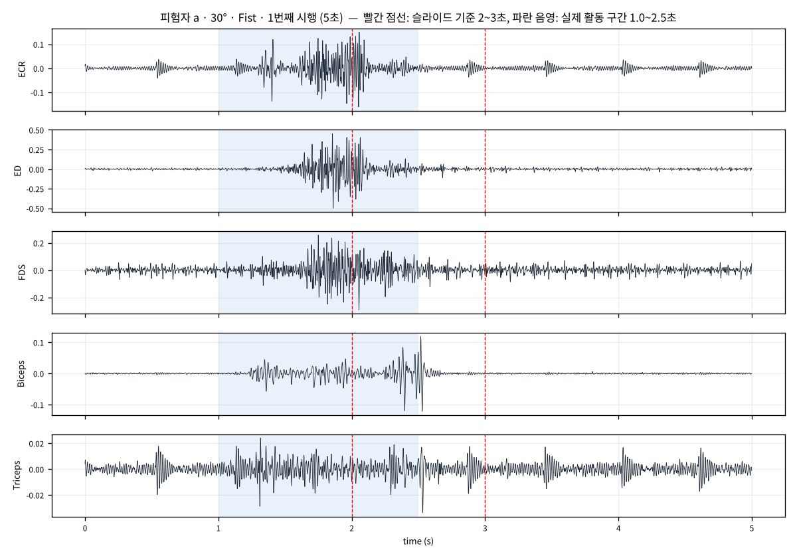
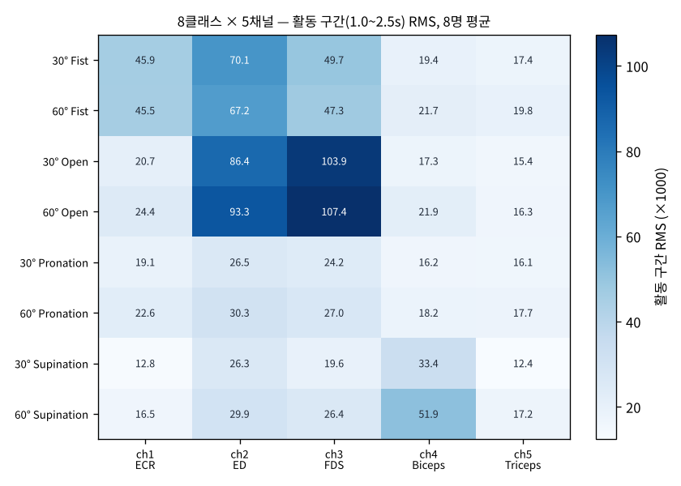
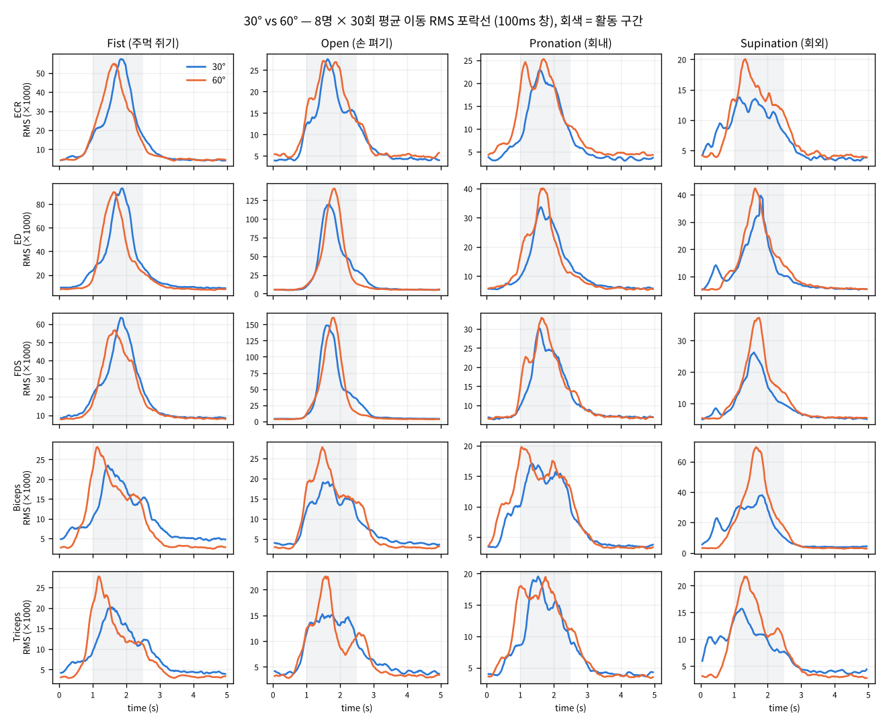

# Step 2 · 1주차 — 문제 정의와 데이터 이해 (sEMG 손동작 × 팔꿈치 각도 동시 분류)

전완 3채널 + 상완 2채널 sEMG로 **손동작 4종(주먹 쥐기 · 손 펴기 · 회내 · 회외) × 팔꿈치 각도 2종(30° · 60°)
= 8클래스**를 한 번에 분류하는 문제의 1주차 실습입니다. 이번 주는 모델을 만들지 않고, 8클래스가 무엇인지 이해하고
신호를 눈으로 확인하는 데까지 진행했습니다.

- 원 논문: *Simultaneous Classification of Hand Gestures and Elbow Angles Using sEMG Signals: A Comparison of
  Machine Learning Performances.* Biomedical Engineering Letters (2026). DOI 10.1007/s13534-026-00607-7
- 데이터: https://github.com/TestUser-alt-dev/sEMG-Hand-Gesture-Elbow-Angle-Dataset (논문 원 데이터, 8명 × 8클래스 × 30회)
- 작성자: 19146809 · 컴퓨터공학과 · 김지훈

---

## 1. 실습 단계와 산출물

| 단계 | 내용 | 산출물 |
|---|---|---|
| 1. 환경 점검 | Step 1 가상환경 + `xgboost` 추가 설치, 버전 확인 | `results/env_check.txt` |
| 2. 데이터 확보 | 논문 원 데이터(방법 A와 동일한 8클래스 구성) 64개 CSV | `data/README.md` |
| 3. 데이터 구조 파악 | 클래스별 시행 수, 배열 모양, 채널 수 | `results/data_summary.json`, `results/class_counts.csv` |
| 4. 채널별 신호 그리기 | 5채널 파형, 30° vs 60° 비교, 클래스×채널 RMS | `results/ch5_example.png`, `results/angle_side_by_side.png`, `results/angle_envelope_grid.png`, `results/class_channel_rms.png` |
| 5. 클래스 설계안 | 8클래스 목록 · 채널 대응 · 설계 근거 · 대안 · 확장 문제 | 리포트 ⑤ 페이지, `results/angle_rms_table.csv` |

## 2. 데이터 요약

| 항목 | 값 |
|---|---|
| 파일 | 64개 = 8명(a~h) × 2각도 × 4동작, 이름 규칙 `[피험자]_[각도] [동작].csv` |
| 파일 구조 | 파일 하나에 30회 시행이 연속 기록됨. `mark` 열이 1인 위치가 시행 시작(간격 4,999~5,001샘플) |
| 열 | `bandpass 1`~`bandpass 5`(5채널), `time`, `onset`, `mark` |
| 시행 배열 | 시행당 (5000, 5) — 5초 × 1,000Hz × 5채널, 전체 (1920, 5000, 5) |
| 클래스 분포 | 8클래스 모두 240시행 (8명 × 30회) — 불균형 없음 |
| 채널 | ch1 ECR(요측수근신근) · ch2 ED(총지신근) · ch3 FDS(천지굴근) · ch4 Biceps(상완이두근) · ch5 Triceps(상완삼두근) |

슬라이드의 `label_of`는 `30_fist_trial01.csv` 형식을 가정하므로, 실제 파일명에 맞게 정규식으로 고치고
`mark` 기준으로 시행을 자르는 `split_trials`를 추가했습니다(`src/week1_lab.py`).

## 3. 주요 관찰



- **동작 구간 위치가 슬라이드와 다릅니다.** 1,920개 시행의 포락선 최대 시점 중앙값은 **1.69초**(10~90%: 1.21~2.07초)이고,
  최대가 2~3초 안에 오는 시행은 14.7%뿐입니다. 실제 활동 구간은 약 1.0~2.5초이므로, 다음 주 2초 세그먼트를 자를 때 반영해야 합니다.
- **동작은 채널 패턴으로 갈립니다.** 주먹 쥐기는 전완 3채널, 손 펴기는 ED·FDS, 회외는 Biceps가 지배적이고, 회내는 모든 채널이 낮습니다.



- **각도는 같은 패턴의 크기를 바꿉니다.** 활동 구간 RMS의 60°/30° 비율은 20칸 중 17칸에서 1보다 컸고(1.0~1.5배),
  가장 큰 차이는 **회외의 Biceps 1.55배(8명 중 7명)**입니다. 주먹 쥐기·손 펴기의 전완 채널은 0.95~1.08배로 거의 변하지 않았고
  피험자마다 방향이 엇갈렸습니다.



| 동작 \ 채널 | ECR | ED | FDS | Biceps | Triceps |
|---|---:|---:|---:|---:|---:|
| Fist | 0.99 (4/8) | 0.96 (4/8) | 0.95 (5/8) | 1.11 (6/8) | 1.14 (7/8) |
| Open | 1.18 (7/8) | 1.08 (5/8) | 1.03 (4/8) | 1.27 (6/8) | 1.06 (6/8) |
| Pronation | 1.18 (7/8) | 1.15 (7/8) | 1.12 (5/8) | 1.12 (5/8) | 1.10 (5/8) |
| Supination | 1.29 (7/8) | 1.14 (4/8) | 1.34 (8/8) | **1.55 (7/8)** | 1.38 (7/8) |

60°/30° 활동 구간 RMS 비율, 괄호는 60°가 더 큰 피험자 수.

## 4. 실행 방법

```bash
# 0) 환경 (Step 1 가상환경 재사용)
source .venv/bin/activate            # Windows: .venv\Scripts\activate
pip install -r requirements.txt      # 신규 패키지는 xgboost

# 1) 데이터 받기 (약 930MB, 저장소에는 포함하지 않음)
git clone https://github.com/TestUser-alt-dev/sEMG-Hand-Gesture-Elbow-Angle-Dataset data/sEMG-Hand-Gesture-Elbow-Angle-Dataset

# 2) 실습 단계 1~5 실행 → results/ 생성 (약 1분)
python src/week1_lab.py

```

## 5. 파일 설명

| 파일 | 설명 |
|---|---|
| `src/week1_lab.py` | 실습 1~5단계 전체. 환경 점검, 파일 목록, 파일명 파싱(`label_of`), `mark` 기준 시행 분할, 구조 요약, 5채널 그림, 30°/60° 비교, 클래스×채널 RMS |
| `report/generate_report.py` | 제출물 5개 항목(① 환경 확인 ② 데이터 요약 ③ 신호 그림 ④ 비교 관찰 ⑤ 클래스 설계안)을 PDF 한 개로 생성 |
| `report/19146809_김지훈.pdf` | 제출 리포트 |
| `results/` | 실습 산출물(그림, 요약 JSON/CSV) |

## 6. 다음 주(2주차) 준비

- 노치·대역통과 필터 → 2초 세그먼트 → 200ms 윈도우 → RMS·MAV·WL·ZC·SSC × 5채널 = 25차원 특징
- 이번 주 `results/ch5_example.png`는 필터 전후 비교에 다시 씁니다.
- 세그먼트 위치는 슬라이드의 2~3초가 아니라 실제 활동 구간(약 1.0~2.5초)을 기준으로 잡을 예정입니다.
